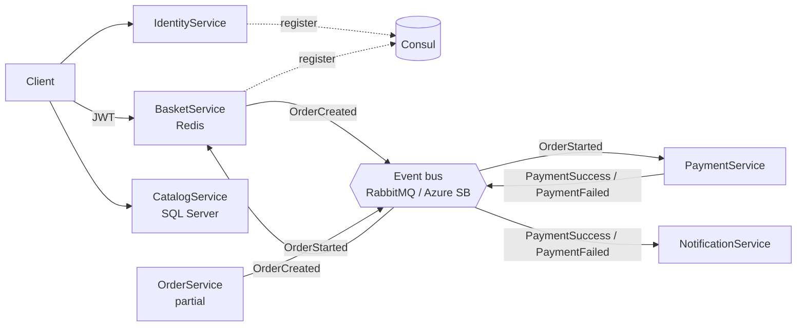

# SellingProject

An e-commerce microservices sample in .NET 5 built around a custom, pluggable event bus (RabbitMQ or Azure Service Bus).

> **📦 Archived** — this is a learning project from 2021, kept for reference. It is not maintained and is not production-ready. Several services are partially implemented (see [Notes](#notes--limitations)).


## Overview

The core of the project is a hand-written **event bus building block**: services publish and subscribe to integration events through `IEventBus`, and `EventBusFactory` returns a RabbitMQ (direct exchange, one durable queue per subscriber/event) or Azure Service Bus (topic + filtered subscriptions) implementation from the same `EventBusConfig`.

| Service | State | What it does |
|---|---|---|
| IdentityService.Api | working | Issues a JWT for any user name (demo login), registers itself in Consul |
| CatalogService.Api | working | Catalog items, brands and types on SQL Server (EF Core), seeded from files; serves product pictures |
| BasketService.Api | working | Per-user basket in Redis (JWT-protected), publishes `OrderCreatedIntegrationEvent` on checkout, registers in Consul |
| PaymentService.Api | working | Consumes `OrderStartedIntegrationEvent`, publishes payment success/failure (driven by the `PaymentSucess` config flag) |
| NotificationService | working | Console app that logs payment success/failure events |
| OrderService (Api / Application / Domain / Infrastructure) | partial | DDD domain model + MediatR/AutoMapper application layer; API and infrastructure are not implemented |
| Web.ApiGateway, Blazor WebApp | template | Project scaffolds only |

## Architecture



Event names are derived from the event type name with the `IntegrationEvent` suffix removed (e.g. `OrderStartedIntegrationEvent` → routing key `OrderStarted`); each subscriber gets its own queue/subscription named `<SubscriberClientAppName>.<EventName>`.

## Tech stack

.NET 5 · ASP.NET Core Web API · RabbitMQ.Client 6 · Microsoft.Azure.ServiceBus 5 · Polly · EF Core 5 (SQL Server) · StackExchange.Redis · Consul · MediatR · AutoMapper · JWT Bearer · MSTest

## Project structure

```
SellingProject.sln
src/
├── BuildingBlocks/EventBus/
│   ├── EventBus.Base/              # IEventBus, BaseEventBus, in-memory subscription manager
│   ├── EventBus.RabbitMQ/          # RabbitMQ implementation + persistent connection
│   ├── EventBus.AzureServiceBus/   # Azure Service Bus implementation
│   └── EventBus.Factory/           # Creates the configured implementation
├── Services/
│   ├── BasketService/  CatalogService/  IdentityService/
│   ├── OrderService/ (Api, Application, Domain, Infrastructure)
│   ├── PaymentService/  NotificationService/
├── ApiGateways/WebApiGateway/      # Template
└── Clients/BlazorWebApp/           # Template
Test/BuildingBlock/EventBus.UnitTest/  # Event bus tests (need a live broker)
```

## Getting started

**Prerequisites**

- .NET 5 SDK — or a newer SDK; to run on a machine without the .NET 5 runtime set `DOTNET_ROLL_FORWARD=Major`
- Docker

```bash
docker run -d --name rabbitmq -p 5672:5672 -p 15672:15672 rabbitmq:3-management
docker run -d --name redis -p 6379:6379 redis:7
docker run -d --name consul -p 8500:8500 hashicorp/consul:1.15 agent -dev -client=0.0.0.0
docker run -d --name sqlserver -e ACCEPT_EULA=Y -e 'MSSQL_SA_PASSWORD=Your_password123' \
  -p 1433:1433 mcr.microsoft.com/mssql/server:2022-latest

dotnet build SellingProject.sln
```

The RabbitMQ implementation connects to `localhost` with the default `guest` account. CatalogService defaults to SQL Server LocalDB (Windows); elsewhere override it, e.g. `export ConnectionString='Server=localhost,1433;Database=catalog;User Id=sa;Password=Your_password123;TrustServerCertificate=True'`.

Most services share the template port `5000/5001` in `launchSettings.json`, so start each with its own URL:

```bash
dotnet run --project src/Services/IdentityService/IdentityService.Api --urls http://localhost:5005
dotnet run --project src/Services/BasketService/BasketService.Api  --urls http://localhost:5003
dotnet run --project src/Services/CatalogService/CatalogService.Api --urls http://localhost:5004
dotnet run --project src/Services/PaymentService/PaymentService.Api --urls http://localhost:5006
dotnet run --project src/Services/NotificationService/NotificationService
```

## Notes / limitations

- OrderService has no API endpoints, persistence or subscription to `OrderCreatedIntegrationEvent`, so the checkout → order → payment flow is not connected end to end.
- The identity service accepts any user name and uses a hard-coded demo signing key shared with BasketService.
- The event bus tests are integration tests: they need RabbitMQ or an Azure Service Bus connection string.
- .NET 5 is out of support; the projects are kept on their original target framework.
